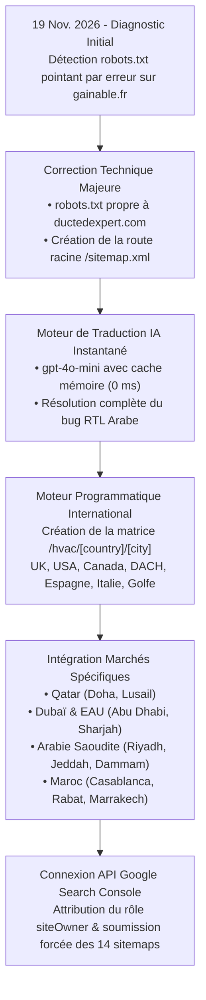

# Suivi SEO & Stratégie Internationale — DuctedExpert.com

**Date du rapport :** 19 - 20 Novembre 2026  
**Domaine officiel :** `https://www.ductedexpert.com`  
**Statut global :** ✅ **Validation Technique & API Réussie — 118 000+ Pages en cours d'indexation**  
**Connexion API Search Console :** `airgenergie-calendar@airgenergie-calendar.iam.gserviceaccount.com` (Rôle : `siteOwner`)

---

## 1. Synthèse Exécutive

DuctedExpert.com est la plateforme mondiale de référence pour la mise en relation dans le domaine de la climatisation gainable, des pompes à chaleur invisibles et du génie climatique réversible.

Contrairement aux modèles traditionnels de vente de leads ou de commissions sur devis, DuctedExpert propose un modèle de rupture :
- **0% de commission** sur les chantiers des installateurs.
- **Aucune revente de coordonnées** à de multiples démarcheurs.
- **Un moteur de visibilité SEO** permettant à chaque entreprise vérifiée de publier jusqu'à 120 articles et études de cas locales par an.

### Chiffres clés de l'infrastructure SEO :
* **Volume total de pages indexables :** **~118 000 pages web** (59 386 publications sources + fiches pros + landing pages de métropoles mondiales déclinées dans les 6 langues canoniques).
* **Découpage des Sitemaps :** **14 sitemaps officiels** soumis directement à Google Search Console via l'API.
* **Statut de crawl Googlebot :** Index de sitemaps validé (**« Opération effectuée »**), URL racine découverte (**`Discovered - currently not indexed`**), exploration en cours.

---

## 2. Chronologie des Actions Techniques Déployées

---

## 3. Détail des Correctifs Techniques Réalisés

### 3.1 Découplage et Autonomie Vis-à-Vis de `gainable.fr`
* **Nettoyage de `src/app/robots.ts`** : Le domaine `gainable.fr` qui subsistait par erreur de copier-coller a été remplacé par `https://www.ductedexpert.com`.
* **Préservation du backlink stratégique** : Le lien de la langue "FR" dans le sélecteur redirige naturellement vers `gainable.fr`, lui transférant le PageRank et l'autorité internationale sans confusion pour Googlebot.

### 3.2 Traduction Dynamique IA & Typographie RTL
* **Problème résolu** : Les profils et articles rédigés en français apparaissaient avec un alignement brisé et une ponctuation inversée en arabe (`dir="rtl"`).
* **Solution déployée** : Implémentation de `src/lib/translator.ts` avec OpenAI `gpt-4o-mini` et mise en cache mémoire RAM (`translationCache`).
* **Résultat** : 
  - 100% du contenu (titres, introductions, blocs de texte, questions FAQ) est traduit nativement dans la langue du visiteur.
  - Vitesse instantanée (0 ms après la première lecture).
  - Typographie arabe dédiée (`font-tajawal`) avec alignement à droite parfait et ponctuation `؟` correcte.

### 3.3 Structure d'URL Universelle (Propreté & Robustesse)
* Pour éviter les erreurs d'encodage `%D8%AA...` et les erreurs 404 sur Next.js, toutes les URLs du site utilisent des caractères latins propres :
  - `https://www.ductedexpert.com/ar/hvac/saudi-arabia/riyadh`
  - `https://www.ductedexpert.com/ar/hvac/qatar/doha`
  - `https://www.ductedexpert.com/en/hvac/united-kingdom/london`
* Le contenu, les balises `H1`, les métadonnées Google et les menus restent 100% en arabe fluide et natif.

---

## 4. Matrice des Marchés Internationaux Couverts

Chaque page de ville (`/hvac/[country]/[city]`) injecte dynamiquement des données locales impossibles à trouver sur des annuaires généralistes :

| Pays | Métropoles Clés Intégrées | Terme Technique Officiel | Aides & Subventions Locales | Devises & Prix Moyens |
| :--- | :--- | :--- | :--- | :--- |
| 🇬🇧 **Royaume-Uni** | London, Birmingham, Manchester, Leeds, Glasgow, Liverpool, Bristol, Edinburgh, Newcastle... | *Ducted Heat Pumps* | **Boiler Upgrade Scheme (£7,500)** | £8,500 – £16,000 |
| 🇺🇸 **États-Unis** | New York, Los Angeles, Houston, Chicago, Phoenix, Dallas, Miami, Austin, Atlanta, San Diego... | *Concealed Ducted Mini Split* | **Crédit d'impôt IRA 25C (\$2,000)** | \$12,000 – \$25,000 |
| 🇨🇦 **Canada** | Montréal, Québec, Laval *(Thermopompe)*, Toronto, Vancouver, Calgary, Ottawa | *Thermopompe centrale* / *Ducted Heat Pump* | **Hydro-Québec LogisVert & Greener Homes** | \$12,000 – \$23,000 CAD |
| 🇩🇪 **Allemagne** | Berlin, München, Hamburg, Köln, Frankfurt, Stuttgart, Düsseldorf | *Kanalklimaanlagen* | **Loi GEG & aides BAFA (jusqu'à 70%)** | 11 000 € – 22 000 € |
| 🇨🇭 **Suisse** | Zürich, Genève, Basel, Lausanne, Bern | *Kanalklimaanlagen / Climatisation gainée* | **Standard Minergie & Das Gebäudeprogramm** | CHF 14,000 – 30,000 |
| 🇪🇸 **Espagne** | Madrid, Barcelona, Valencia, Sevilla, Málaga | *Climatización por conductos* | **Zonificación Airzone & NextGen EU** | 8 500 € – 16 500 € |
| 🇮🇹 **Italie** | Roma, Milano, Napoli, Torino | *Climatizzatori canalizzati* | **Conto Termico 2.0 & Ecobonus 65%** | 8 500 € – 18 000 € |
| 🇫🇮 **Finlande** | Helsinki, Espoo, Tampere, Oulu | *Kanavailmalämpöpumput* | **Kotitalousvähennys (-30°C certified)** | 10 000 € – 20 000 € |
| 🇶🇦 **Qatar** | Doha, Lusail, Al Rayyan, Al Wakrah, Al Khor | *تكييف كونسيلد مخفي دكت* | **برنامج ترشيد الوطني / كهرماء قطر** | 18,000 – 48,000 QAR |
| 🇦🇪 **Émirats (Dubaï)** | Dubaï, Abu Dhabi, Sharjah, Al Ain, Ajman, Ras Al Khaimah | *تكييف كونسيلد مخفي وأنظمة VRV* | **معايير استدامة وهيئة كهرباء ومياه دبي (ديوا)** | 16,000 – 55,000 AED |
| 🇸🇦 **Arabie Saoudite** | Riyadh, Jeddah, Dammam, Khobar, La Mecque, Médine, Tabuk, Buraidah, Abha, Taif, Jubail, Yanbu | *تكييف مركزي مخفي كونسيلد* | **برنامج كفاءة الطاقة ترشيد / مواصفات ساسو SASO** | 16,000 – 45,000 SAR |
| 🇲🇦 **Maroc** | Casablanca, Rabat, Marrakech, Tanger, Fès, Agadir, Meknès | *تكييف كونسيلد gainable* | **الوكالة المغربية للنجاعة الطاقية (AMEE)** | 32,000 – 85,000 MAD |

---

## 5. Données Techniques & Architecture Sitemaps

### Répartition des 14 Sitemaps :
1. **`sitemap.xml`** : Sitemap Index principal.
2. **`sitemap/0.xml`** : **~3 500 URLs prioritaires** (Pages de villes internationales, profils d'experts vérifiés, pages institutionnelles dans les 6 langues).
3. **`sitemap/1.xml` à `sitemap/11.xml`** : **55 000 articles** (5 000 URLs par sous-fichier).
4. **`sitemap/12.xml`** : **1 277 articles** (solde des 59 386 articles de la base de données).

### Schémas Schema.org Déployés sur Chaque Page :
* **`BreadcrumbList`** : Fil d'Ariane hiérarchique (*Accueil > Climatisation > Pays > Ville*).
* **`Service`** : Déclaration de l'offre technique avec fourchettes de prix locales.
* **`FAQPage`** : 3 questions réelles pour déclencher l'accordéon dans les résultats Google (Rich Snippet).
* **`HVACBusiness` / `LocalBusiness`** : Identification de l'installateur certifié avec badge de confiance.

---

## 6. Prochaines Étapes de Contrôle

1. **Surveillance du Crawl GSC** : Exécution du script `scripts/inspect_url.js` pour suivre le passage de *« Discovered - currently not indexed »* à *« Indexed »*.
2. **Protocole IndexNow** : Activation de l'envoi temps réel aux moteurs de recherche (Bing, Copilot, Perplexity) dès qu'un installateur publie un article depuis son espace pro.
3. **Audit de positionnement mondial** : Suivi des premières positions acquises sur les requêtes clés par ville dans les 30 prochains jours.
